<p align="center">
  
</p>

<h1 align="center">Tool Borrow</h1>

<p align="center">
  <strong>Odoo 18 Community Module for Internal Tool & Device Lending Management</strong><br/>
  Full lifecycle tracking from request to return, with role-based access and portal self-service.
</p>

<p align="center">
  <a href="#features">Features</a> &bull;
  <a href="#architecture">Architecture</a> &bull;
  <a href="#screenshots">Screenshots</a> &bull;
  <a href="#installation">Installation</a> &bull;
  <a href="#configuration">Configuration</a> &bull;
  <a href="#security">Security</a> &bull;
  <a href="#testing">Testing</a> &bull;
  <a href="README_zh_TW.md">中文文件</a>
</p>

<p align="center">
  
  
  
  
  
</p>

---

## Overview

**Tool Borrow** is a standalone Odoo 18 Community module that lets organizations manage shared tools and devices through a structured borrow-and-return workflow. Managers approve or reject loan requests; the system tracks availability automatically; portal users can browse and request tools without backend access.

| Challenge | Solution |
|-----------|----------|
| Tools disappear without records | Every tool gets a unique auto-generated code (`TL-001`, `TL-002`, …) and full loan history |
| No approval process for lending | Multi-step workflow: Draft → Pending → Approved → Borrowed → Returned (or Rejected) |
| Managers lack visibility | Category-based organization with kanban dashboards showing tool and loan counts |
| Portal users can't self-serve | Branded portal pages let users browse tools and submit borrow requests directly |
| Access control is all-or-nothing | 2-tier permission model: everybody requests, only Equipment Managers approve and configure; workflow fields are enforced by the ORM |

---

## Features

### Tool Management
- **Auto-generated codes** — Sequential tool codes (`TL-001`, `TL-002`, …) via `ir.sequence`
- **Stage-based tracking** — Configurable stages with color coding (default: In Service, Under Maintenance, Retired)
- **Availability state** — Computed state: Available, Unavailable, Under Maintenance
- **One-click status toggle** — "Set to Maintenance" / "Set to Available" buttons on form view
- **Category organization** — Group tools by category with kanban and list views
- **Dynamic properties** — Per-category custom fields via `PropertiesDefinition`
- **Portal user list** — Record which portal users a tool is meant for (`portal_user_ids`; informational, not an access filter)

### Loan Workflow
- **Full lifecycle** — Draft → Pending → Approved → Borrowed → Returned (or Rejected)
- **Manager approval** — Equipment Managers approve or reject pending requests
- **Auto-availability** — Tool state updates automatically on borrow and return
- **Loan history** — Complete audit trail embedded in the tool form view
- **Chatter integration** — All status changes tracked via `mail.thread`

### Portal Self-Service
- **Equipment hub** — Branded portal page with "Equipment Tools" and "My Loans" cards
- **Tool browsing** — Portal and internal users can browse all active tools
- **Borrow requests** — Submit loan requests directly from the portal
- **Loan tracking** — View loan status and history from the portal

### Access Control
- **Internal Users** — Read-only access to all tools; create, submit and withdraw their own loan requests
- **Equipment Managers** (`tool_borrow.group_tool_manager`) — Full CRUD on tools, categories, stages and loans; approve, reject, confirm pickup/return
- **Portal Users** — Browse active tools and create, submit and withdraw their own requests via the portal
- **Workflow fields guarded by the ORM** — Only Equipment Managers can set a loan's state, approval or dates, or create a loan for somebody else

---

## Architecture

### Module Dependency Graph

```
┌─────────────────────────────────────────────────────┐
│                    tool_borrow                       │
│                                                      │
│  ┌─────────────┐  ┌──────────────┐  ┌─────────────┐ │
│  │ tool.stage   │  │tool.category │  │  tool.tool   │ │
│  │  (stages)    │  │  (grouping)  │  │  (assets)   │ │
│  └──────┬──────┘  └──────┬───────┘  └──────┬──────┘ │
│         │                │                  │        │
│         └────────────────┼──────────────────┘        │
│                          │                            │
│                   ┌──────┴───────┐                    │
│                   │  tool.loan    │                    │
│                   │  (workflow)   │                    │
│                   └──────────────┘                    │
└──────────────────────┬────────────────────────────────┘
                       │ depends
           ┌───────────┼───────────┐
           ▼           ▼           ▼
        [base]      [mail]     [portal]
```

### Data Model

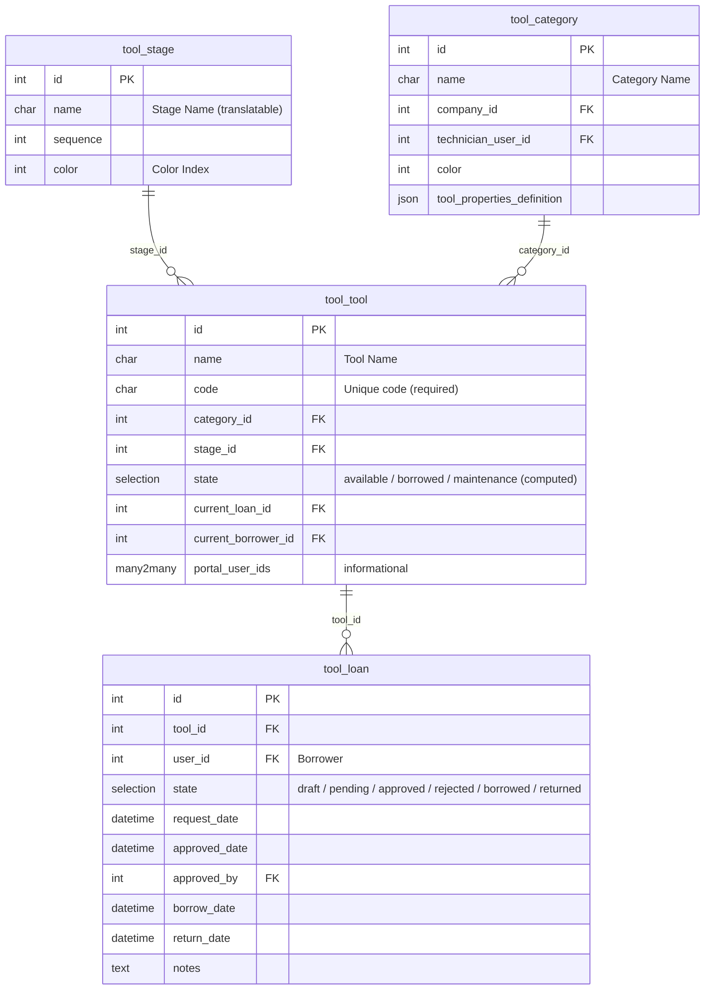

### Loan State Machine

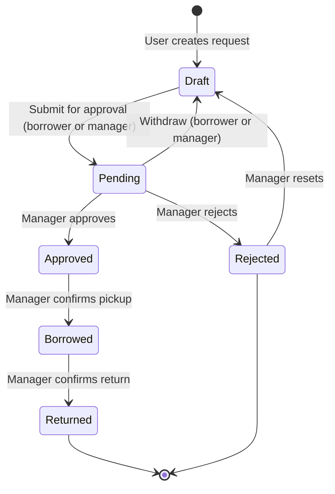

### Request-Response Flow

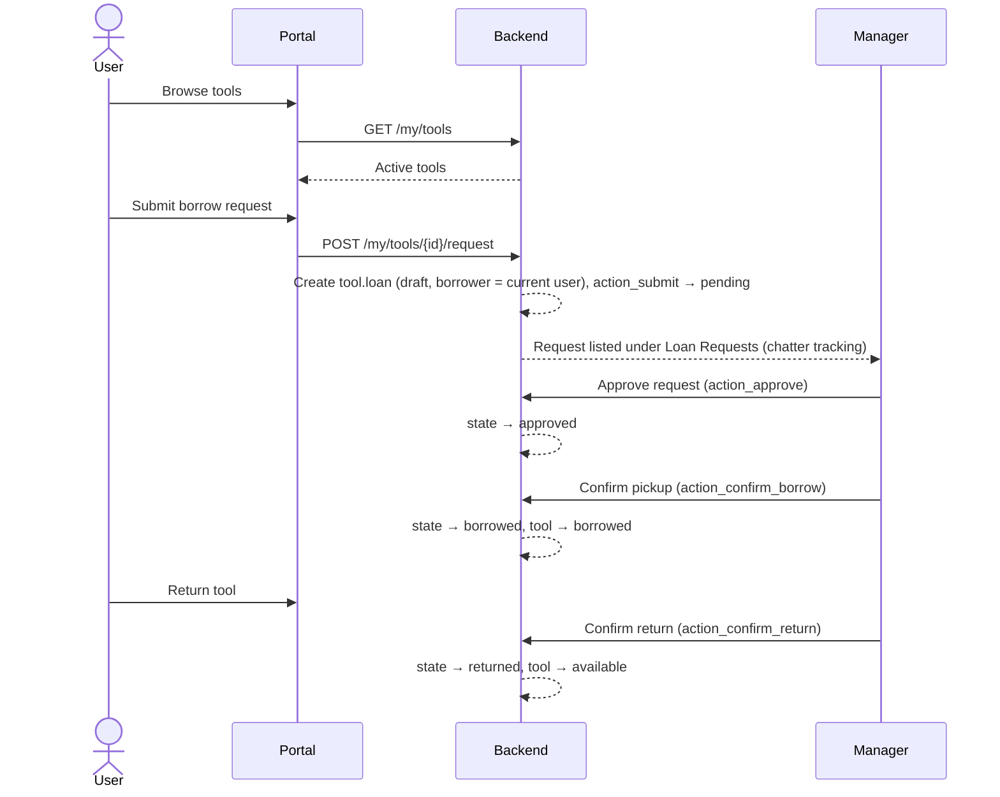

### Directory Structure

```
Odoo_tool-device_borrow/
├── tool_borrow/                     # The Odoo module (the only directory to deploy)
│   ├── __init__.py
│   ├── __manifest__.py              # v18.0.1.3.2, depends: base, mail, portal
│   ├── controllers/
│   │   └── portal.py                # /my/equipment, /my/tools, /my/loans, POST /my/tools/<id>/request
│   ├── data/
│   │   └── tool_stage_data.xml      # Default stages + default category
│   ├── i18n/
│   │   └── zh_TW.po                 # Traditional Chinese translations
│   ├── models/
│   │   ├── ir_http.py               # Portal pages follow the user's language
│   │   ├── tool_loan.py             # Loan model, workflow actions, ORM guard on workflow fields
│   │   └── tool_tool.py             # Stage, Category, Tool, Property models
│   ├── security/
│   │   ├── ir.model.access.csv      # ACL rules
│   │   └── tool_borrow_security.xml # Equipment Manager group + record rules
│   ├── static/
│   │   ├── description/icon.png     # Module icon (orange wrench)
│   │   └── src/img/                 # SVG icons for portal
│   ├── tests/                       # Odoo regression tests (--test-enable)
│   │   ├── common.py
│   │   ├── test_loan_workflow_security.py
│   │   └── test_portal_hardening.py
│   └── views/
│       ├── menu_views.xml           # App menu structure
│       ├── portal_templates.xml     # Portal pages
│       ├── res_users_views.xml      # Removes the legacy "Tool Borrow" user-form tab
│       ├── tool_loan_views.xml      # Loan views
│       └── tool_tool_views.xml      # Tool/Category/Stage views
├── scripts/
│   └── e2e/                         # External E2E scripts against a running instance (not Odoo tests; credentials from env vars)
│       ├── e2e_config.py
│       ├── e2e_round1_models.py     # Model CRUD, constraints, computed fields (XML-RPC)
│       ├── e2e_round2_security.py   # ACL, record rules, workflow-field guard (XML-RPC)
│       ├── e2e_round3_http.py       # Portal HTTP routes (requests)
│       ├── e2e_round4_browser.py    # Portal UI (Playwright)
│       ├── e2e_round5_supplementary.py
│       └── screenshots/
└── docs/
```

---

## Screenshots

### Backend — Tool List View

Tool inventory with auto-generated codes, stage badges, and portal user assignments. The toolbar provides access to Tools, Borrow Requests, My Loans, and Settings menus.

<p align="center">
  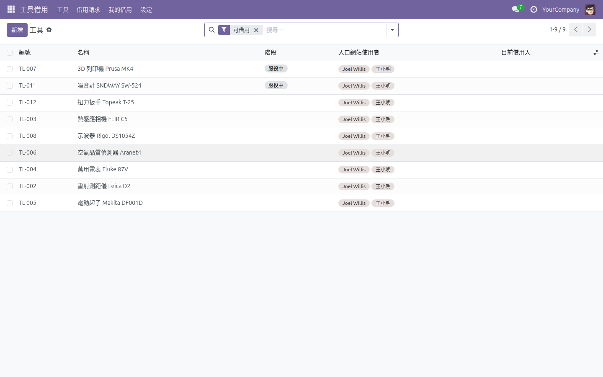
</p>

### Backend — Tool Form View

Detailed tool form showing service status, borrow state, category, portal user assignment, and embedded loan history with chatter. The "Set to Maintenance" button toggles the tool's service status.

<p align="center">
  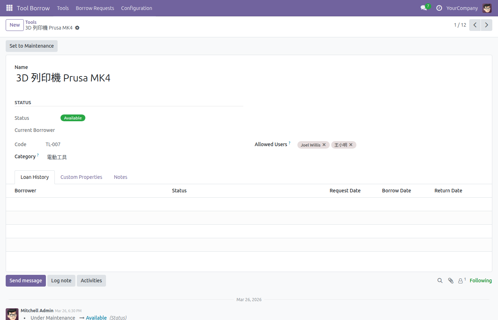
</p>

### Backend — Category Kanban

Category dashboard with kanban cards showing tool count (wrench icon) and active loan count (handshake icon) per category.

<p align="center">
  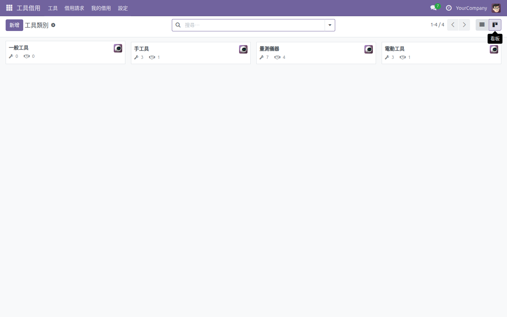
</p>

### Backend — Category Form

Category detail with two smart buttons (Tools and Loans) for quick navigation. Includes responsible person, color selection, and notes.

<p align="center">
  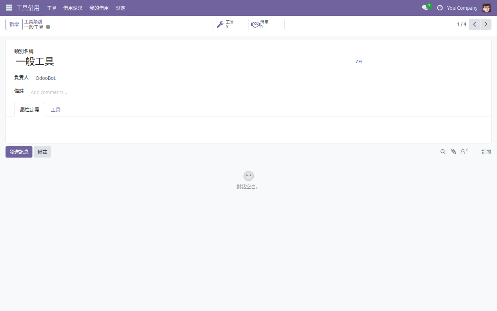
</p>

### Backend — Stage Configuration

Stage management with name and color fields. Default stages: In Service (服役中), Under Maintenance (維護中), Retired (已退役).

<p align="center">
  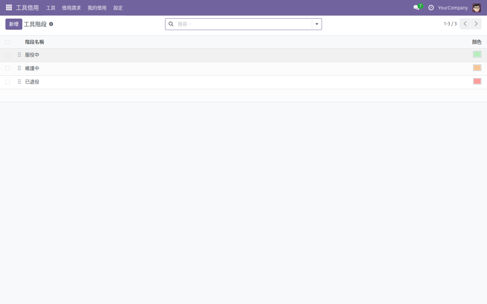
</p>

### Backend — Loan Request List

All borrow requests with color-coded state badges (Pending / Approved / Borrowed / Returned / Rejected), borrower info, and date tracking.

<p align="center">
  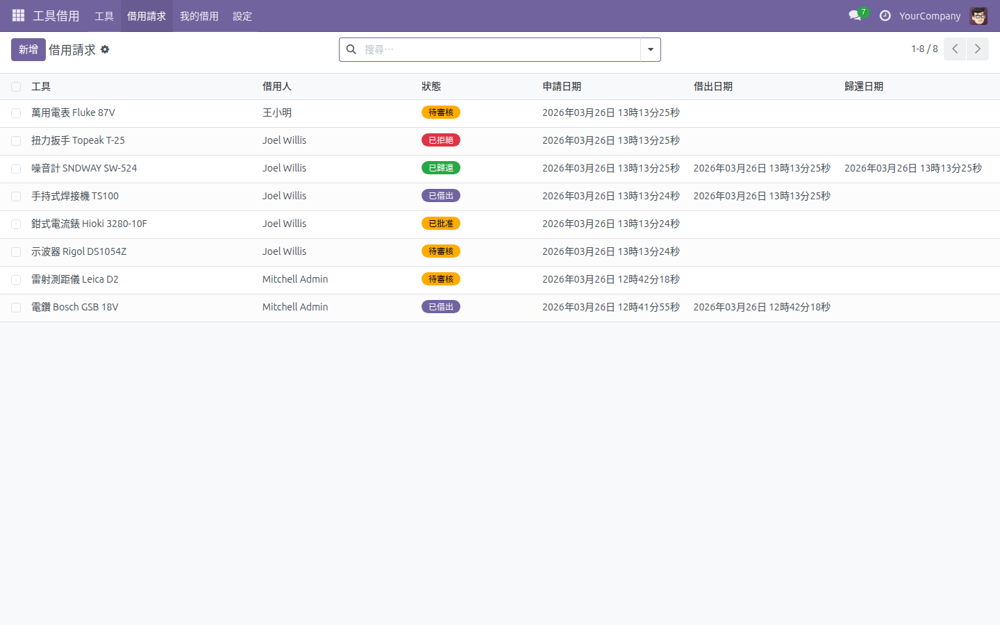
</p>

### Backend — Loan Form

Loan request detail with approval/rejection workflow buttons, tool information, borrower, dates, and notes.

<p align="center">
  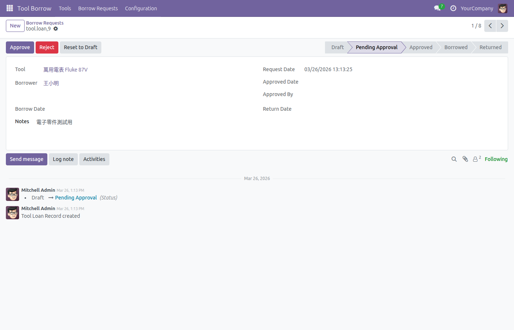
</p>

### Backend — User Access Control

Equipment Managers are assigned through Odoo's native **Access Rights** tab on the user form (**Tool Borrow → Equipment Manager**). The former `tool_borrow_access` selection field and its custom user-form tab have been removed; the screenshot below predates that change.

<p align="center">
  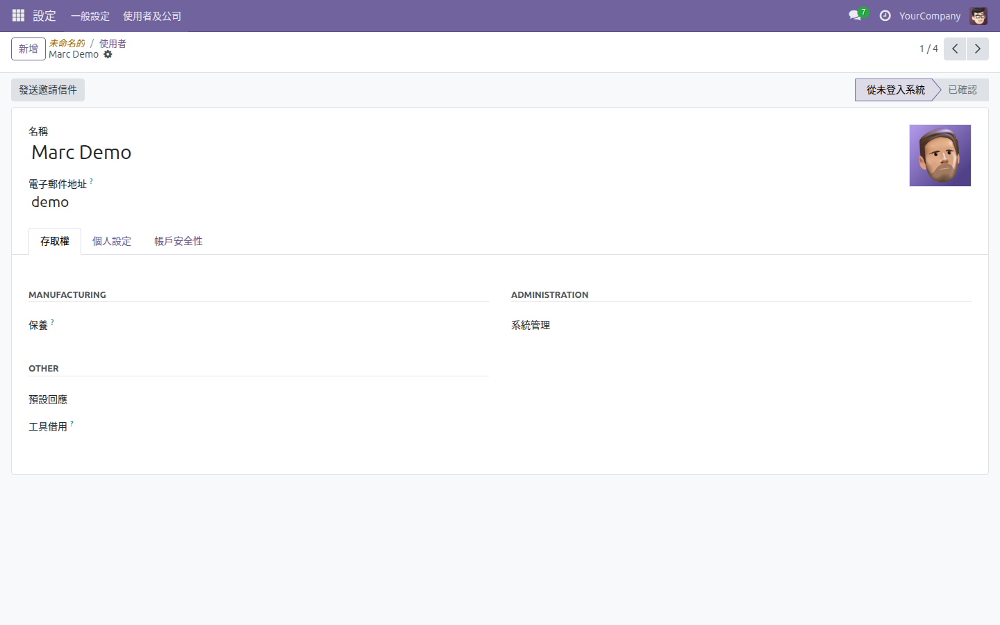
</p>

### Portal — My Account Home

Portal users see "Tools" and "My Loans" cards on their account page, providing self-service access to equipment borrowing.

<p align="center">
  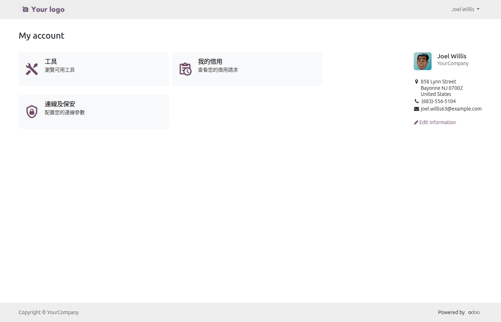
</p>

### Portal — Equipment Listing

Portal tool catalog showing available tools with category, status, and detail links.

<p align="center">
  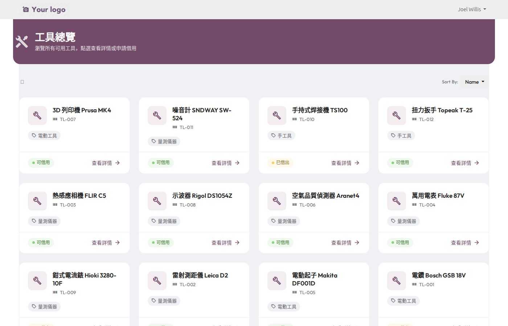
</p>

### Portal — Tool Detail

Individual tool detail page in the portal with specifications and borrow request functionality.

<p align="center">
  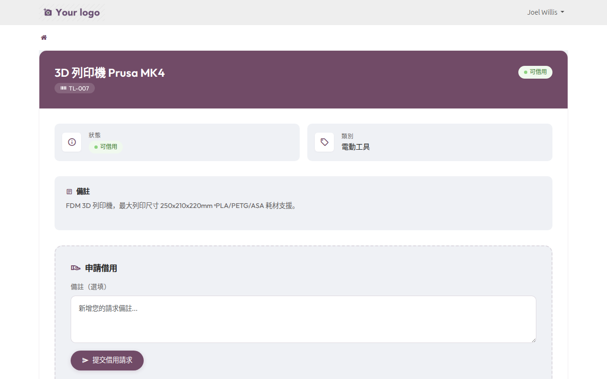
</p>

### Portal — My Loans

Portal loan history showing all borrow requests and their current status.

<p align="center">
  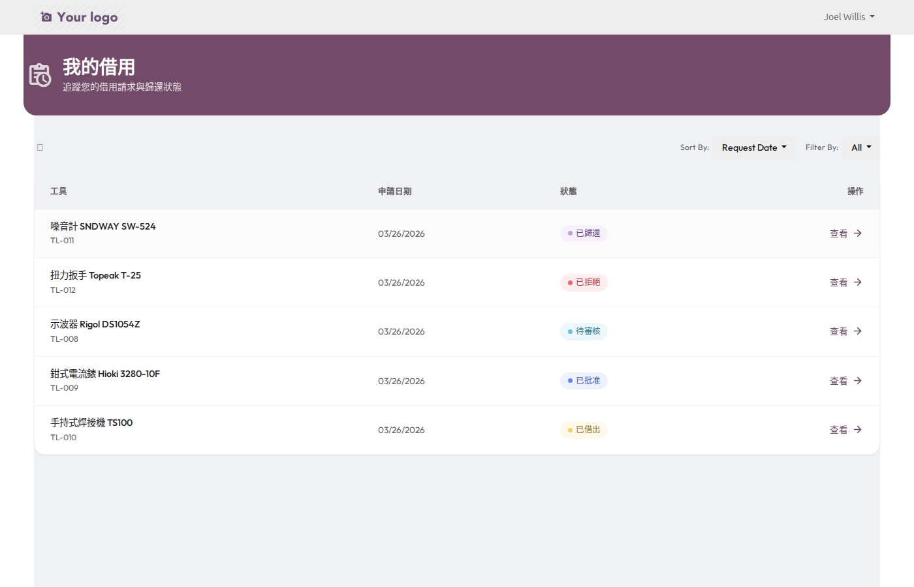
</p>

### Portal — Loan Detail

Individual loan detail page showing status, dates, tool information, and notes.

<p align="center">
  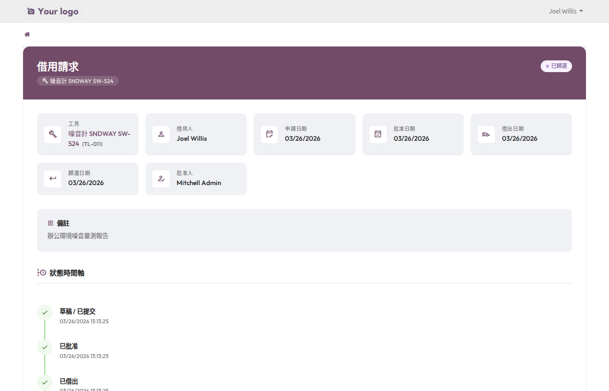
</p>

---

## Installation

### Prerequisites

- Odoo 18.0 Community or Enterprise
- Python 3.10+
- PostgreSQL 14+

### Step 1: Deploy Module

Copy the `tool_borrow/` directory to your Odoo addons path:

```bash
cp -r tool_borrow /path/to/odoo/addons/
```

Or using Docker/Podman, mount as an extra addon:

```bash
podman run -d \
  -v ./tool_borrow:/mnt/extra-addons/tool_borrow:ro \
  -e EXTRA_ADDONS=/mnt/extra-addons \
  odoo:18
```

### Step 2: Update Apps List

In Odoo, go to **Apps** → **Update Apps List** → search for "Tool Borrow" → click **Install**.

### Step 3: Verify Installation

After installation, the **Tool Borrow** app (wrench icon) appears in the main menu. No user is made an Equipment Manager automatically: add the people who approve loans (the administrator included, if needed) to **Equipment Manager** under **Settings → Users → Access Rights → Tool Borrow**.

---

## Configuration

### 1. Stages

Navigate to **Tool Borrow → Settings → Stages** to manage tool lifecycle stages. Three defaults are created on install:

| Stage | Color | Description |
|-------|-------|-------------|
| In Service (服役中) | Green | Tool is operational and available for borrowing |
| Under Maintenance (維護中) | Orange | Tool is temporarily out of service |
| Retired (已退役) | Red | Tool is permanently decommissioned |

### 2. Categories

Navigate to **Tool Borrow → Settings → Categories** to organize tools by type. Each category supports:

- **Responsible** person (default technician)
- **Custom properties** — Dynamic fields applied to all tools in the category
- **Color** for kanban card display

### 3. User Access

Access follows Odoo groups; there is no per-user access field. Add approvers to **Equipment Manager** in **Settings → Users → Access Rights → Tool Borrow**:

| User type | Backend | Portal | Loans |
|-----------|---------|--------|-------|
| Portal user (`base.group_portal`) | — | Browse active tools, request | Own loans: create (draft), submit, withdraw a pending request |
| Internal user (`base.group_user`) | Tools (read), My Loans | Same as portal | Own loans: create (draft), submit, withdraw a pending request |
| Equipment Manager (`tool_borrow.group_tool_manager`) | Full CRUD on tools, loans, stages, categories | Same as portal | All loans: approve, reject, confirm pickup/return, reset rejected to draft, delete |

### 4. Portal Users

Each tool has a **Portal Users** field (`portal_user_ids`) to note which portal users it is meant for. It is informational: the portal currently lists every active tool to every logged-in user, and record rules do not filter on it.

---

## Security

### Permission Model

```
┌──────────────────────────────────────────────────────────────┐
│                     tool_borrow Access                        │
├───────────────────┬──────────────────────────────────────────┤
│  Portal Users     │  Read all tools / stages / categories    │
│  (group_portal)   │  Own loans: create draft, submit,        │
│                   │  withdraw pending; no delete             │
├───────────────────┼──────────────────────────────────────────┤
│  Internal Users   │  Same as portal (backend: Tools, My      │
│  (group_user)     │  Loans)                                  │
├───────────────────┼──────────────────────────────────────────┤
│  Equipment Mgr    │  Full CRUD: tools, stages, categories,   │
│ (group_tool_      │  properties, all loans; approve/reject,  │
│  manager)         │  confirm pickup/return, reset rejected   │
└───────────────────┴──────────────────────────────────────────┘
```

### Security Features

- **Record rules** — non-managers only see and write their own loans
- **Workflow fields enforced by the ORM** — `state`, `approved_by`, `approved_date`, `borrow_date`, `return_date` and `request_date` can only be created or written by Equipment Managers (or by the workflow actions, which check the transition first and then write them as superuser). A non-manager create is always pinned to a draft for the current user, so `default_*` context keys or `ir.default` rows cannot forge an approval; tool and borrower can only change while the loan is a draft
- **Workflow actions** — approve / reject / confirm pickup / confirm return require Equipment Manager; submit and withdraw require the borrower (or a manager); only managers can reset a rejected request
- **Portal hardening** — archived tools cannot be viewed or requested; unknown `sortby` / `filterby` values fall back to the default
- **Backend menus** — Loan Requests and Configuration are only shown to Equipment Managers

---

## Testing

### Module tests (Odoo test runner)

`tool_borrow/tests/` contains the regression tests that ship with the module (`TransactionCase` for the loan workflow and field guard, `HttpCase` for the portal routes):

```bash
odoo -d <test_db> -i tool_borrow --test-enable --test-tags /tool_borrow --stop-after-init
```

### External E2E scripts (`scripts/e2e/`)

The `scripts/e2e/e2e_round*.py` scripts drive a **running** instance over XML-RPC, HTTP and Playwright. They are not part of the module (nothing under `tool_borrow/` imports them and `--test-enable` never loads them) and they create and delete their own test tools and loans, so point them at a disposable database.

| Script | Focus | Needs |
|--------|-------|-------|
| `e2e_round1_models.py` | Model CRUD, constraints, computed fields | admin |
| `e2e_round2_security.py` | ACL, record rules, workflow-field guard | admin, manager, user, portal, portal2 |
| `e2e_round3_http.py` | Portal HTTP routes, CSRF, pagination, sort/filter | admin, user, portal, portal2 |
| `e2e_round4_browser.py` | Portal UI, RWD, E2E flow, XSS (Playwright) | admin, portal, portal2, noaccess |
| `e2e_round5_supplementary.py` | Edge cases, ACL per role, counters | admin, manager, user, portal, portal2 |

Prerequisites on the target database: `tool_borrow` installed; the admin login used for setup and cleanup is in **Equipment Manager** (the scripts stop otherwise, or add it when `TB_E2E_GRANT_ADMIN_MANAGER=1`); users for the other roles exist (`testmanager` internal + Equipment Manager, `testuser` internal, `portal` and `xiaoming` portal, plus a `noaccess` login for the round 4 home-page check). Every state change goes through the `action_*` methods, as non-managers can no longer write workflow fields.

Credentials come only from environment variables; no password has a default (see `scripts/e2e/e2e_config.py`):

```bash
export TB_E2E_URL=http://localhost:8069 TB_E2E_DB=tool_borrow_e2e
export TB_E2E_ADMIN_PASSWORD=...        # TB_E2E_ADMIN_LOGIN defaults to admin
export TB_E2E_MANAGER_PASSWORD=... TB_E2E_USER_PASSWORD=...
export TB_E2E_PORTAL_PASSWORD=... TB_E2E_PORTAL2_PASSWORD=... TB_E2E_NOACCESS_PASSWORD=...
# optional: TB_E2E_<ROLE>_LOGIN to use other logins, TB_E2E_SCREENSHOT_DIR for round 4
python3 scripts/e2e/e2e_round2_security.py
```

Round 3 and 5 need `requests`; round 4 needs `playwright` (`pip install playwright && playwright install chromium`).

### Playwright UI checks (v1.3.0)

7 Playwright browser checks verified the UI after the v1.3.0 changes:

| # | Test | Result |
|---|------|--------|
| 1 | Stage list view shows only name + color columns | Pass |
| 2 | Stage CRUD — inline create with name + color | Pass |
| 3 | Category form — exactly 2 smart buttons (Tools + Loans) | Pass |
| 4 | Category kanban — wrench + handshake icons, no cog | Pass |
| 5 | Tool maintenance/available toggle buttons | Pass |
| 6 | Module icon loads correctly (PNG, 2125 bytes) | Pass |
| 7 | Stage form has no is_closed/fold fields, 3 stages | Pass |

---

## Changelog

### v1.3.2 (2026-11)

- `tool.loan` workflow fields (state, approval, dates) are enforced by the ORM: only Equipment Managers can set them or create loans for somebody else; creates by others are pinned to a draft
- Borrowers may submit and withdraw their own requests; resetting a rejected request is manager-only
- Portal: archived tools cannot be viewed or requested; unknown sort/filter values no longer raise
- New module regression tests in `tool_borrow/tests/`; the old XML-RPC suites moved to `scripts/e2e/` with credentials from environment variables

### v1.3.0 (2026-05)

- Simplified `tool.stage` — removed `is_closed` and `fold` fields
- Removed maintenance tracking from `tool.category`
- New transparent-background module icon (round orange wrench)
- Redesigned `tool.category` to mirror `maintenance.equipment.category`
- Added color picker to tool stages
- Rewrote test suites for stage-based architecture
- Added Playwright UI test suite (7/7 passing)

### v1.2.0 (2026-04)

- 2-tier permission redesign (User → Manager hierarchy)
- Portal Equipment Borrowing hub with breadcrumb navigation
- Dynamic brand color integration
- Complete Traditional Chinese (zh_TW) translations (144 strings)

### v1.1.0 (2026-03)

- Auto-generated tool codes via `ir.sequence`
- Category-based tool organization with kanban views
- Loan request workflow with approval states
- Portal self-service for tool browsing and borrow requests
- Role-based access control

### v1.0.0 (2026-03)

- Initial release — basic tool and loan management

---

## Support

- **Author:** [WoowTech](https://www.woowtech.com)
- **Issues:** [GitHub Issues](https://github.com/WOOWTECH/Odoo_tool-device_borrow/issues)
- **Repository:** [github.com/WOOWTECH/Odoo_tool-device_borrow](https://github.com/WOOWTECH/Odoo_tool-device_borrow)

---

## License

This module is licensed under the [LGPL-3](https://www.gnu.org/licenses/lgpl-3.0.html) license.

---

<p align="center">
  <sub>Built with &#10084; by <a href="https://www.woowtech.com">WOOWTECH</a></sub>
</p>
