<p align="center">
  
</p>

<h1 align="center">工具借用 Tool Borrow</h1>

<p align="center">
  <strong>Odoo 18 社群版模組 — 內部工具與設備借用管理系統</strong><br/>
  從申請到歸還的完整生命週期追蹤，搭配角色權限控管與入口網站自助服務。
</p>

<p align="center">
  <a href="#功能特色">功能特色</a> &bull;
  <a href="#系統架構">系統架構</a> &bull;
  <a href="#系統截圖">系統截圖</a> &bull;
  <a href="#安裝方式">安裝方式</a> &bull;
  <a href="#系統設定">系統設定</a> &bull;
  <a href="#權限控管">權限控管</a> &bull;
  <a href="#測試">測試</a> &bull;
  <a href="README.md">English</a>
</p>

<p align="center">
  
  
  
  
  
</p>

---

## 概述

**工具借用（Tool Borrow）** 是一套獨立的 Odoo 18 社群版模組，讓組織透過結構化的借還流程來管理共用工具與設備。管理者審核借用請求；系統自動追蹤可用狀態；入口網站使用者無需存取後台即可瀏覽與申請工具。

| 問題 | 解決方案 |
|------|----------|
| 工具借出後無紀錄可查 | 每件工具自動生成唯一編號（`TL-001`、`TL-002`、…），並保留完整借用歷史 |
| 借用缺乏審批流程 | 多階段工作流程：草稿 → 待審核 → 已批准 → 已借出 → 已歸還（或已拒絕） |
| 管理者缺乏整體掌握度 | 依類別組織，看板儀表板顯示各類別工具數量與借用數量 |
| 入口網站使用者無法自助操作 | 品牌化入口頁面，使用者可直接瀏覽工具並提交借用請求 |
| 權限控管過於粗糙 | 二層權限模型：人人可申請，只有設備管理者能審核與設定；流程欄位由 ORM 把關 |

---

## 功能特色

### 工具管理
- **自動編號** — 透過 `ir.sequence` 自動產生流水編號（`TL-001`、`TL-002`、…）
- **階段式追蹤** — 可自訂階段搭配顏色標示（預設：服役中、維護中、已退役）
- **可用狀態** — 自動計算狀態：可借用、不可借用、維護中
- **一鍵切換狀態** — 表單上的「設為維護中」/「設為可借用」按鈕
- **類別管理** — 依類別分組，支援看板與列表檢視
- **動態屬性** — 透過 `PropertiesDefinition` 為各類別定義自訂欄位
- **入口使用者清單** — 記錄工具預定給哪些入口使用者（`portal_user_ids`；僅供參考，不是存取篩選）

### 借用流程
- **完整生命週期** — 草稿 → 待審核 → 已批准 → 已借出 → 已歸還（或已拒絕）
- **管理者審批** — 設備管理者審核或拒絕待審請求
- **自動更新狀態** — 借出與歸還時自動更新工具可用狀態
- **借用歷史** — 完整的稽核軌跡嵌入在工具表單中
- **討論串整合** — 所有狀態變更透過 `mail.thread` 追蹤

### 入口網站自助服務
- **設備中心** — 品牌化入口頁面，包含「設備工具」與「我的借用」卡片
- **工具瀏覽** — 入口與內部使用者可瀏覽所有啟用中的工具
- **借用申請** — 直接從入口網站提交借用請求
- **借用追蹤** — 從入口網站查看借用狀態與歷史

### 存取控制
- **一般使用者** — 唯讀存取所有工具；可建立、送出、撤回自己的借用請求
- **設備管理者**（`tool_borrow.group_tool_manager`）— 工具、類別、階段與借用完整 CRUD；核准、拒絕、確認取件／歸還
- **入口使用者** — 透過入口網站瀏覽啟用中的工具，並建立、送出、撤回自己的請求
- **流程欄位由 ORM 把關** — 只有設備管理者能設定借用的狀態、核准資訊與日期，或替別人建立借用

---

## 系統架構

### 模組相依圖

```
┌─────────────────────────────────────────────────────┐
│                    tool_borrow                       │
│                                                      │
│  ┌─────────────┐  ┌──────────────┐  ┌─────────────┐ │
│  │ tool.stage   │  │tool.category │  │  tool.tool   │ │
│  │   (階段)     │  │   (類別)     │  │   (工具)    │ │
│  └──────┬──────┘  └──────┬───────┘  └──────┬──────┘ │
│         │                │                  │        │
│         └────────────────┼──────────────────┘        │
│                          │                            │
│                   ┌──────┴───────┐                    │
│                   │  tool.loan    │                    │
│                   │   (借用)      │                    │
│                   └──────────────┘                    │
└──────────────────────┬────────────────────────────────┘
                       │ 相依
           ┌───────────┼───────────┐
           ▼           ▼           ▼
        [base]      [mail]     [portal]
```

### 資料模型

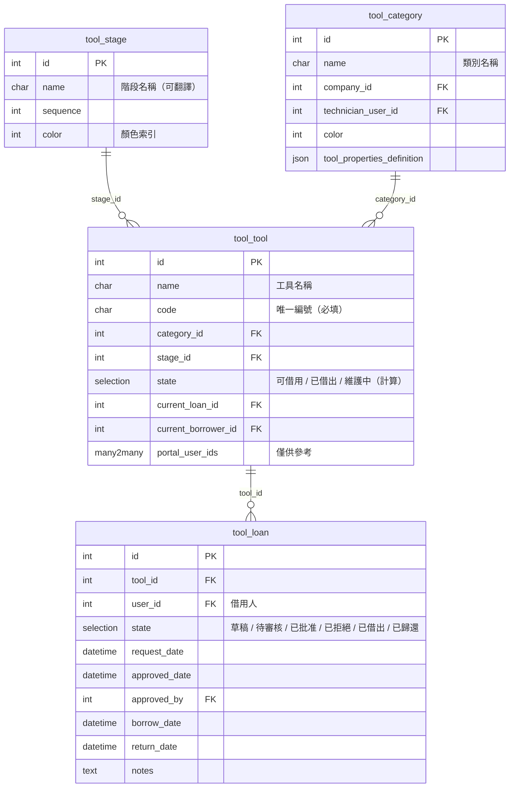

### 借用狀態機

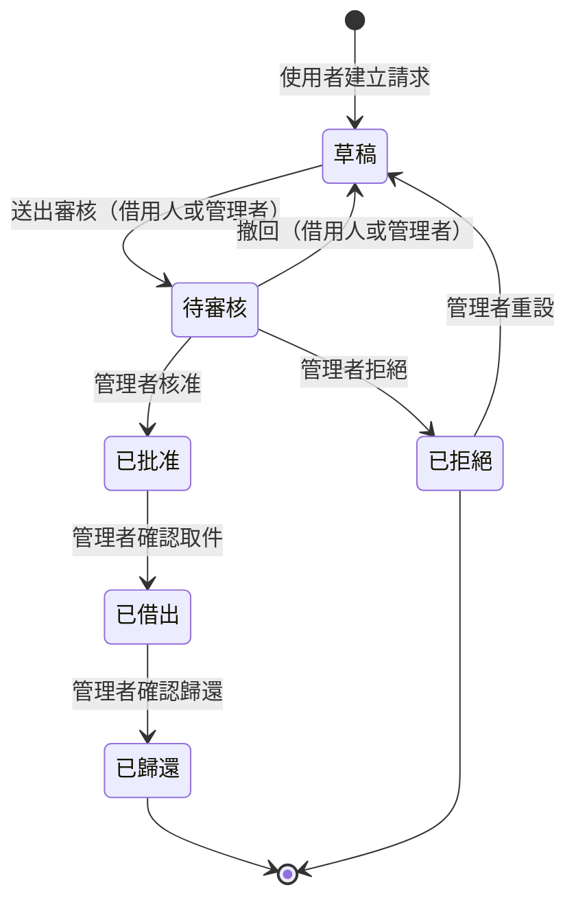

### 請求回應流程

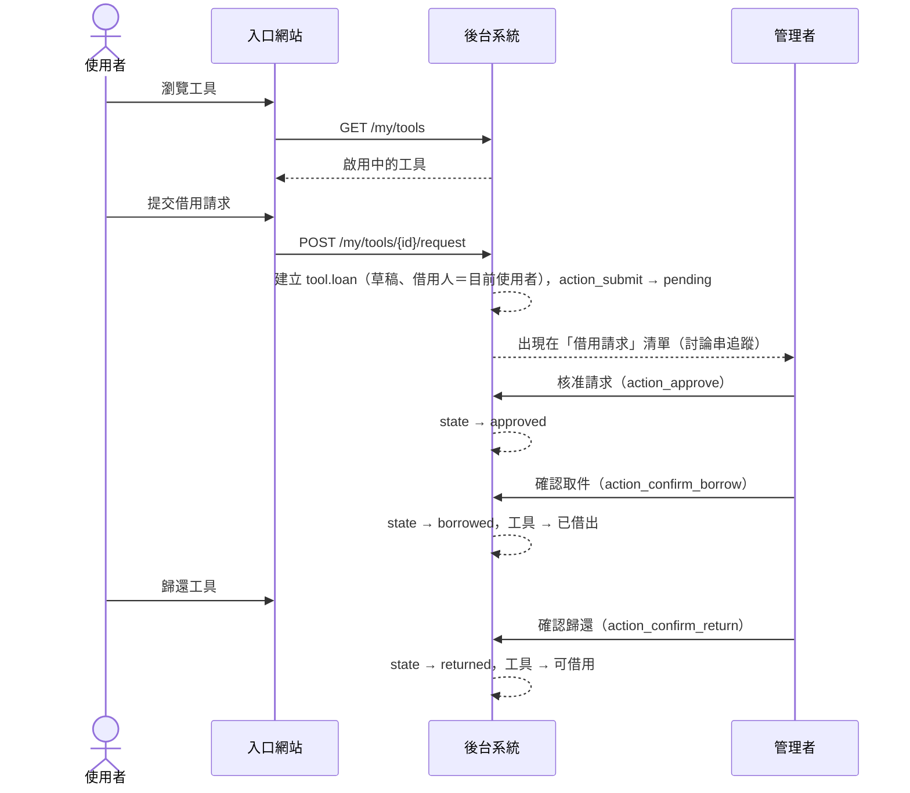

### 目錄結構

```
Odoo_tool-device_borrow/
├── tool_borrow/                     # Odoo 模組本體（部署時只需要這個目錄）
│   ├── __init__.py
│   ├── __manifest__.py              # v18.0.1.3.2，相依：base、mail、portal
│   ├── controllers/
│   │   └── portal.py                # /my/equipment、/my/tools、/my/loans、POST /my/tools/<id>/request
│   ├── data/
│   │   └── tool_stage_data.xml      # 預設階段＋預設類別
│   ├── i18n/
│   │   └── zh_TW.po                 # 繁體中文翻譯
│   ├── models/
│   │   ├── ir_http.py               # 入口頁面依使用者語言顯示
│   │   ├── tool_loan.py             # 借用模型、流程動作、流程欄位的 ORM 把關
│   │   └── tool_tool.py             # 階段、類別、工具、屬性模型
│   ├── security/
│   │   ├── ir.model.access.csv      # ACL 規則
│   │   └── tool_borrow_security.xml # 設備管理者群組＋記錄規則
│   ├── static/
│   │   ├── description/icon.png     # 模組圖示（橘色扳手）
│   │   └── src/img/                 # 入口 SVG 圖示
│   ├── tests/                       # Odoo 回歸測試（--test-enable）
│   │   ├── common.py
│   │   ├── test_loan_workflow_security.py
│   │   └── test_portal_hardening.py
│   └── views/
│       ├── menu_views.xml           # 應用程式選單
│       ├── portal_templates.xml     # 入口頁面
│       ├── res_users_views.xml      # 移除舊的使用者表單「工具借用」分頁
│       ├── tool_loan_views.xml      # 借用檢視
│       └── tool_tool_views.xml      # 工具/類別/階段檢視
├── scripts/
│   └── e2e/                         # 對執行中站台跑的外部 E2E 腳本（非 Odoo 測試；帳密讀環境變數）
│       ├── e2e_config.py
│       ├── e2e_round1_models.py     # 模型 CRUD、約束、計算欄位（XML-RPC）
│       ├── e2e_round2_security.py   # ACL、記錄規則、流程欄位把關（XML-RPC）
│       ├── e2e_round3_http.py       # 入口 HTTP 路由（requests）
│       ├── e2e_round4_browser.py    # 入口 UI（Playwright）
│       ├── e2e_round5_supplementary.py
│       └── screenshots/
└── docs/
```

---

## 系統截圖

### 後台 — 工具列表

工具清單顯示自動編號、階段徽章、入口使用者指派。工具列提供工具、借用請求、我的借用、設定等選單。

<p align="center">
  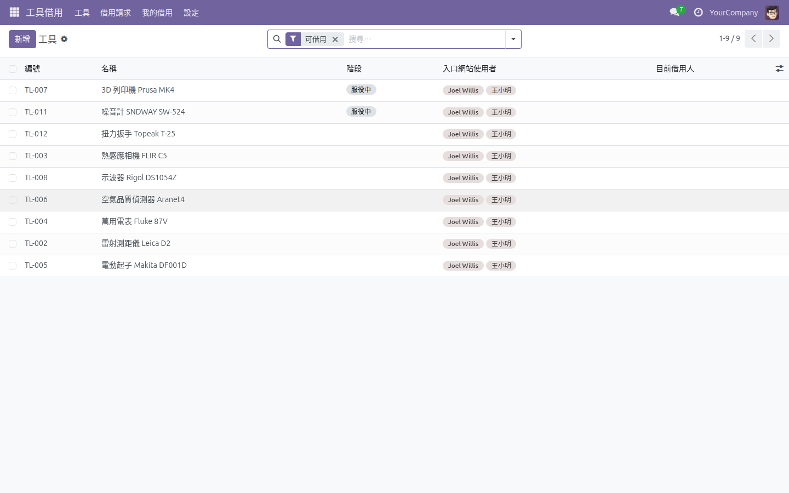
</p>

### 後台 — 工具表單

詳細的工具表單，顯示服役狀態、借用狀態、類別、入口使用者指派，以及嵌入式借用歷史與討論串。「設為維護中」按鈕可切換工具的服役狀態。

<p align="center">
  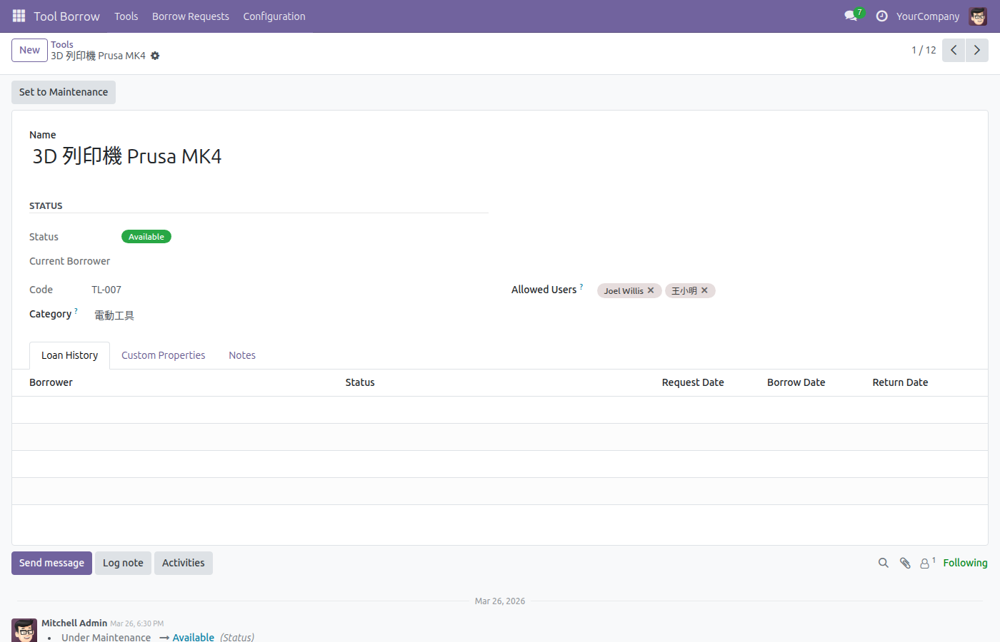
</p>

### 後台 — 類別看板

類別儀表板以看板卡片顯示各類別的工具數量（扳手圖示）與進行中借用數量（握手圖示）。

<p align="center">
  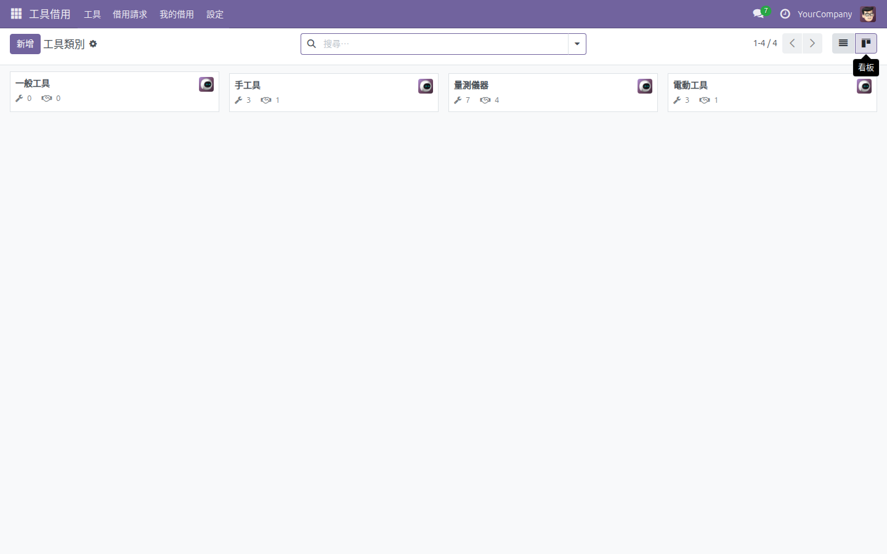
</p>

### 後台 — 類別表單

類別詳情頁，包含兩個智慧按鈕（工具與借用）可快速導覽。包含負責人員、顏色選擇與備註。

<p align="center">
  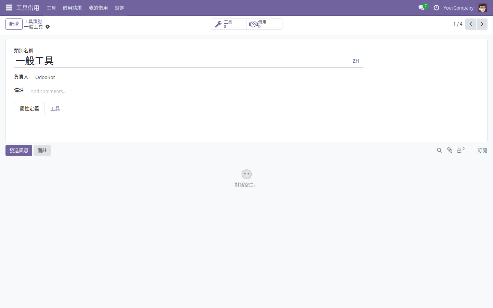
</p>

### 後台 — 階段設定

階段管理，提供名稱與顏色欄位。預設階段：服役中、維護中、已退役。

<p align="center">
  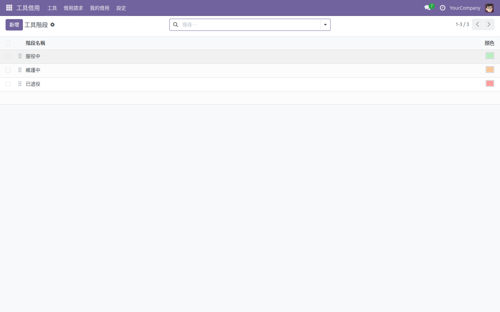
</p>

### 後台 — 借用請求列表

所有借用請求，以顏色標示狀態徽章（待審核/已批准/已借出/已歸還/已拒絕），包含借用人資訊與日期追蹤。

<p align="center">
  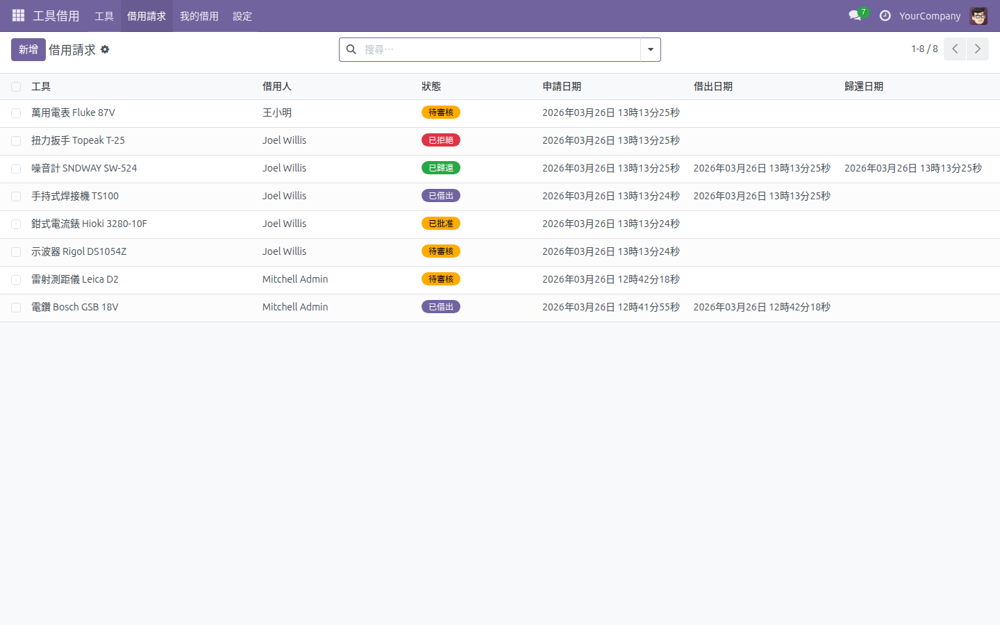
</p>

### 後台 — 借用表單

借用請求詳情，包含審批/拒絕工作流程按鈕、工具資訊、借用人、日期與備註。

<p align="center">
  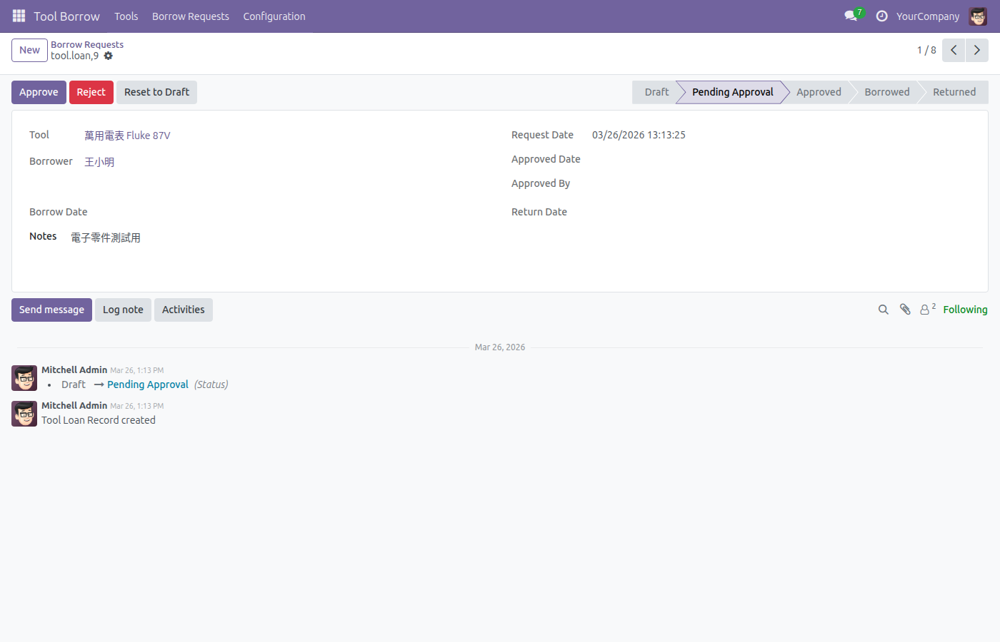
</p>

### 後台 — 使用者權限設定

設備管理者改由 Odoo 原生的使用者表單 **存取權限** 分頁指派（**Tool Borrow → Equipment Manager**）。舊的 `tool_borrow_access` 選擇欄位與自訂的使用者表單分頁都已移除；下圖是移除前的畫面。

<p align="center">
  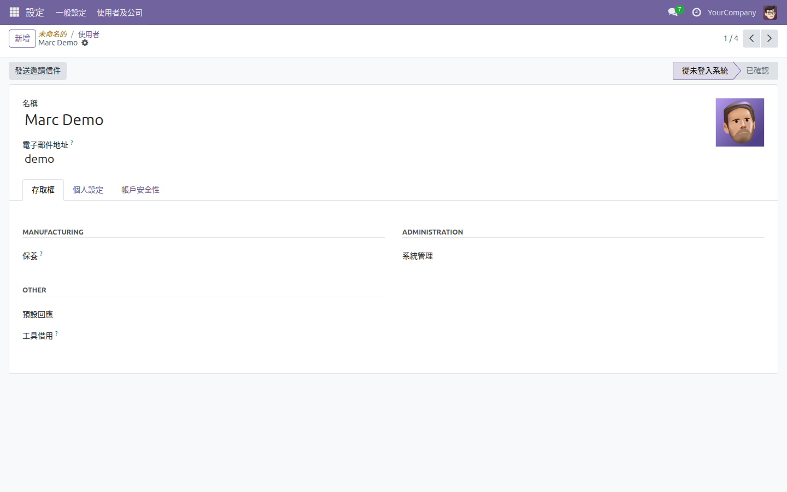
</p>

### 入口 — 我的帳戶首頁

入口使用者在帳戶頁面看到「工具」與「我的借用」卡片，提供設備借用的自助存取。

<p align="center">
  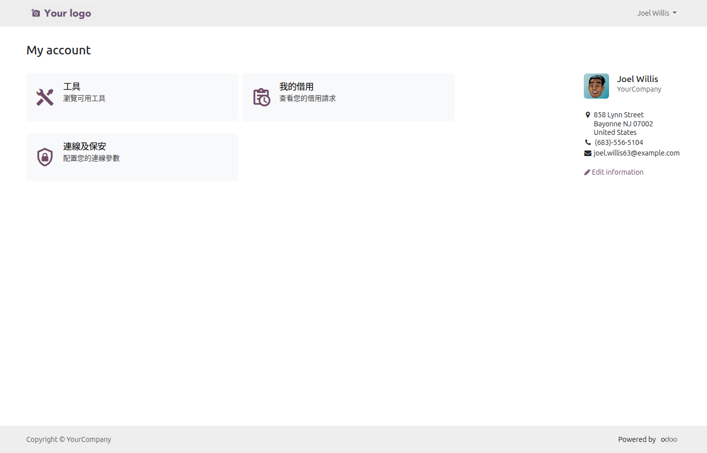
</p>

### 入口 — 設備清單

入口工具目錄，顯示可用工具的類別、狀態與詳情連結。

<p align="center">
  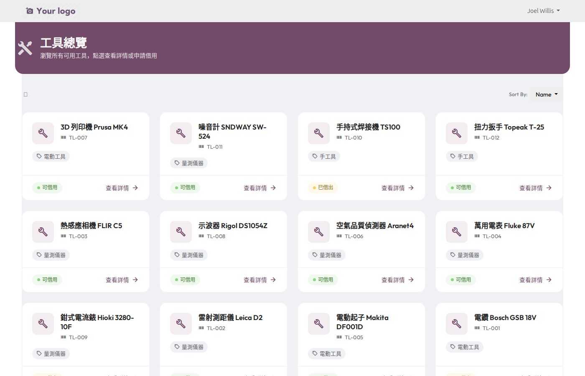
</p>

### 入口 — 工具詳情

入口網站中的個別工具詳情頁，包含規格與借用請求功能。

<p align="center">
  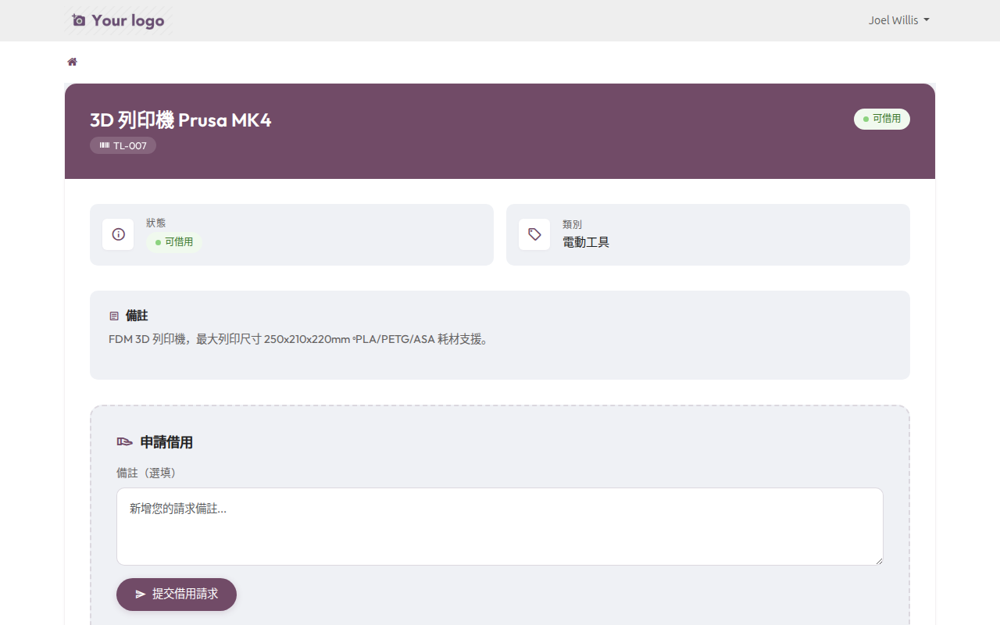
</p>

### 入口 — 我的借用

入口借用歷史，顯示所有借用請求及其目前狀態。

<p align="center">
  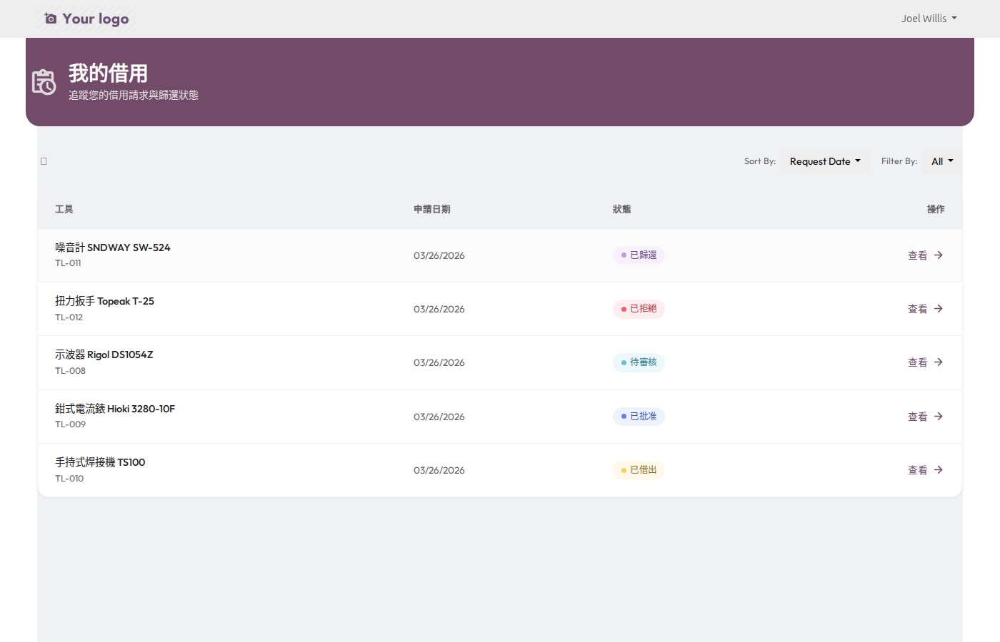
</p>

### 入口 — 借用詳情

個別借用詳情頁，顯示狀態、日期、工具資訊與備註。

<p align="center">
  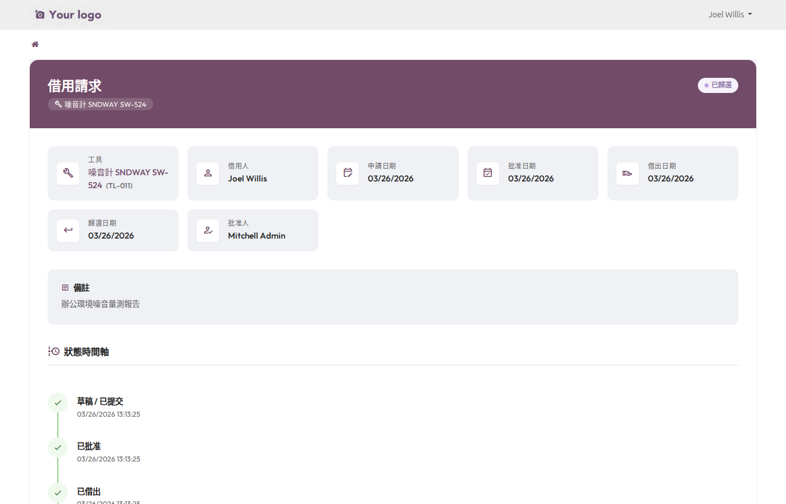
</p>

---

## 安裝方式

### 前置需求

- Odoo 18.0 社群版或企業版
- Python 3.10+
- PostgreSQL 14+

### 步驟一：部署模組

將 `tool_borrow/` 目錄複製到 Odoo 附加模組路徑：

```bash
cp -r tool_borrow /path/to/odoo/addons/
```

或使用 Docker/Podman 掛載為額外附加模組：

```bash
podman run -d \
  -v ./tool_borrow:/mnt/extra-addons/tool_borrow:ro \
  -e EXTRA_ADDONS=/mnt/extra-addons \
  odoo:18
```

### 步驟二：更新應用程式清單

在 Odoo 中，前往 **應用程式** → **更新應用程式清單** → 搜尋「Tool Borrow」→ 點擊 **安裝**。

### 步驟三：驗證安裝

安裝完成後，**工具借用** 應用程式（扳手圖示）會出現在主選單中。安裝時不會自動把任何人設為設備管理者：請到 **設定 → 使用者 → 存取權限 → Tool Borrow**，把負責審核的人（需要的話包含管理員）加入 **Equipment Manager**。

---

## 系統設定

### 1. 階段

前往 **工具借用 → 設定 → 階段** 管理工具生命週期階段。安裝時會建立三個預設值：

| 階段 | 顏色 | 說明 |
|------|------|------|
| 服役中 | 綠色 | 工具正常運作，可供借用 |
| 維護中 | 橘色 | 工具暫時停用 |
| 已退役 | 紅色 | 工具永久淘汰 |

### 2. 類別

前往 **工具借用 → 設定 → 類別** 依類型組織工具。每個類別支援：

- **負責人員**（預設技術人員）
- **自訂屬性** — 套用至該類別所有工具的動態欄位
- **顏色** 用於看板卡片顯示

### 3. 使用者權限

權限依 Odoo 群組決定，沒有逐人設定的存取欄位。到 **設定 → 使用者 → 存取權限 → Tool Borrow** 把審核者加入 **Equipment Manager**：

| 使用者類型 | 後台 | 入口 | 借用 |
|-----------|------|------|------|
| 入口使用者（`base.group_portal`） | — | 瀏覽啟用中的工具、提出申請 | 自己的借用：建立（草稿）、送出、撤回待審請求 |
| 內部使用者（`base.group_user`） | 工具（唯讀）、我的借用 | 同入口使用者 | 自己的借用：建立（草稿）、送出、撤回待審請求 |
| 設備管理者（`tool_borrow.group_tool_manager`） | 工具、借用、階段、類別完整 CRUD | 同入口使用者 | 所有借用：核准、拒絕、確認取件／歸還、把已拒絕重設為草稿、刪除 |

### 4. 入口使用者

每件工具都有 **入口網站使用者** 欄位（`portal_user_ids`），用來記錄這件工具預定給哪些入口使用者。這個欄位僅供參考：目前入口網站會把所有啟用中的工具列給每位登入的使用者，記錄規則也不會依它篩選。

---

## 權限控管

### 權限模型

```
┌──────────────────────────────────────────────────────────────┐
│                   tool_borrow 存取控制                         │
├───────────────────┬──────────────────────────────────────────┤
│  入口使用者        │  讀取所有工具／階段／類別                │
│  (group_portal)   │  自己的借用：建立草稿、送出、撤回待審，  │
│                   │  不能刪除                                │
├───────────────────┼──────────────────────────────────────────┤
│  一般使用者        │  同入口使用者（後台：工具、我的借用）    │
│  (group_user)     │                                          │
├───────────────────┼──────────────────────────────────────────┤
│  設備管理者        │  完整 CRUD：工具、階段、類別、屬性、     │
│ (group_tool_      │  所有借用；核准／拒絕、確認取件／歸還、  │
│  manager)         │  重設已拒絕的請求                        │
└───────────────────┴──────────────────────────────────────────┘
```

### 安全特性

- **記錄規則** — 非管理者只看得到、改得到自己的借用
- **流程欄位由 ORM 把關** — `state`、`approved_by`、`approved_date`、`borrow_date`、`return_date`、`request_date` 只有設備管理者能在建立或寫入時設定（流程動作會先檢查狀態轉移，再以 superuser 寫入）。非管理者建立的借用一律固定為目前使用者的草稿，`default_*` context 或 `ir.default` 都無法偽造核准；工具與借用人只能在草稿時修改
- **流程動作** — 核准／拒絕／確認取件／確認歸還需要設備管理者；送出與撤回限借用人本人（或管理者）；只有管理者能重設已拒絕的請求
- **入口加固** — 已封存的工具不能檢視或申請；未知的 `sortby`／`filterby` 會退回預設值
- **後台選單** — 「借用請求」與「設定」只顯示給設備管理者

---

## 測試

### 模組測試（Odoo 測試執行器）

`tool_borrow/tests/` 是隨模組出貨的回歸測試（`TransactionCase` 測借用流程與欄位把關，`HttpCase` 測入口路由）：

```bash
odoo -d <test_db> -i tool_borrow --test-enable --test-tags /tool_borrow --stop-after-init
```

### 外部 E2E 腳本（`scripts/e2e/`）

`scripts/e2e/e2e_round*.py` 透過 XML-RPC、HTTP 與 Playwright 操作**執行中**的站台。它們不屬於模組（`tool_borrow/` 底下沒有任何地方引用，`--test-enable` 也不會載入），而且會自行建立、刪除測試用的工具與借用，請對可丟棄的資料庫執行。

| 腳本 | 重點 | 需要的角色 |
|------|------|-----------|
| `e2e_round1_models.py` | 模型 CRUD、約束、計算欄位 | admin |
| `e2e_round2_security.py` | ACL、記錄規則、流程欄位把關 | admin、manager、user、portal、portal2 |
| `e2e_round3_http.py` | 入口 HTTP 路由、CSRF、分頁、排序／篩選 | admin、user、portal、portal2 |
| `e2e_round4_browser.py` | 入口 UI、RWD、端到端流程、XSS（Playwright） | admin、portal、portal2、noaccess |
| `e2e_round5_supplementary.py` | 邊緣案例、各角色 ACL、計數 | admin、manager、user、portal、portal2 |

目標資料庫的前提：已安裝 `tool_borrow`；負責建立與清理資料的 admin 帳號要在 **Equipment Manager** 群組（否則腳本會停止；設 `TB_E2E_GRANT_ADMIN_MANAGER=1` 則由腳本加入）；其他角色的使用者已存在（預設 `testmanager` 內部＋設備管理者、`testuser` 內部、`portal` 與 `xiaoming` 入口，另有第四輪首頁檢查用的 `noaccess`）。因為非管理者已不能直接寫流程欄位，所有狀態變更都走 `action_*` 方法。

帳密只從環境變數讀取，任何密碼都沒有預設值（見 `scripts/e2e/e2e_config.py`）：

```bash
export TB_E2E_URL=http://localhost:8069 TB_E2E_DB=tool_borrow_e2e
export TB_E2E_ADMIN_PASSWORD=...        # TB_E2E_ADMIN_LOGIN 預設 admin
export TB_E2E_MANAGER_PASSWORD=... TB_E2E_USER_PASSWORD=...
export TB_E2E_PORTAL_PASSWORD=... TB_E2E_PORTAL2_PASSWORD=... TB_E2E_NOACCESS_PASSWORD=...
# 選用：TB_E2E_<ROLE>_LOGIN 改用其他帳號、TB_E2E_SCREENSHOT_DIR 指定第四輪截圖目錄
python3 scripts/e2e/e2e_round2_security.py
```

第三、五輪需要 `requests`；第四輪需要 `playwright`（`pip install playwright && playwright install chromium`）。

### Playwright UI 檢查（v1.3.0）

v1.3.0 變更後以 7 項 Playwright 瀏覽器檢查驗證 UI：

| # | 測試項目 | 結果 |
|---|---------|------|
| 1 | 階段列表僅顯示名稱 + 顏色欄 | 通過 |
| 2 | 階段 CRUD — 行內建立名稱 + 顏色 | 通過 |
| 3 | 類別表單 — 恰好 2 個智慧按鈕（工具 + 借用） | 通過 |
| 4 | 類別看板 — 扳手 + 握手圖示，無齒輪 | 通過 |
| 5 | 工具維護中/可借用切換按鈕 | 通過 |
| 6 | 模組圖示正確載入（PNG，2125 bytes） | 通過 |
| 7 | 階段表單無 is_closed/fold 欄位，3 個階段 | 通過 |

---

## 版本紀錄

### v1.3.2 (2026-11)

- `tool.loan` 流程欄位（狀態、核准、日期）改由 ORM 把關：只有設備管理者能設定，或替別人建立借用；其他人建立的借用一律固定為草稿
- 借用人可送出、撤回自己的請求；重設已拒絕的請求限管理者
- 入口：已封存的工具不能檢視或申請；未知的排序／篩選值不再報錯
- 新增模組回歸測試 `tool_borrow/tests/`；舊的 XML-RPC 測試套件搬到 `scripts/e2e/`，帳密改讀環境變數

### v1.3.0 (2026-05)

- 簡化 `tool.stage` — 移除 `is_closed` 與 `fold` 欄位
- 從 `tool.category` 移除維護追蹤功能
- 全新透明背景模組圖示（圓形橘色扳手）
- 重新設計 `tool.category`，對齊 `maintenance.equipment.category` 模式
- 新增階段顏色選擇器
- 重寫測試套件以配合階段式架構
- 新增 Playwright UI 測試套件（7/7 通過）

### v1.2.0 (2026-04)

- 二層權限架構重新設計（使用者 → 管理者階層）
- 入口設備借用中心頁面含麵包屑導覽
- 動態品牌色彩整合
- 完整繁體中文（zh_TW）翻譯（144 條字串）

### v1.1.0 (2026-03)

- 透過 `ir.sequence` 自動產生工具編號
- 依類別組織工具，支援看板檢視
- 借用請求工作流程與審批狀態
- 入口自助服務：工具瀏覽與借用請求
- 角色式存取控制

### v1.0.0 (2026-03)

- 首次發佈 — 基本工具與借用管理

---

## 支援

- **作者：** [WoowTech](https://www.woowtech.com)
- **問題回報：** [GitHub Issues](https://github.com/WOOWTECH/Odoo_tool-device_borrow/issues)
- **原始碼庫：** [github.com/WOOWTECH/Odoo_tool-device_borrow](https://github.com/WOOWTECH/Odoo_tool-device_borrow)

---

## 授權

本模組採用 [LGPL-3](https://www.gnu.org/licenses/lgpl-3.0.html) 授權條款。

---

<p align="center">
  <sub>由 <a href="https://www.woowtech.com">WOOWTECH</a> 用心打造 &#10084;</sub>
</p>
